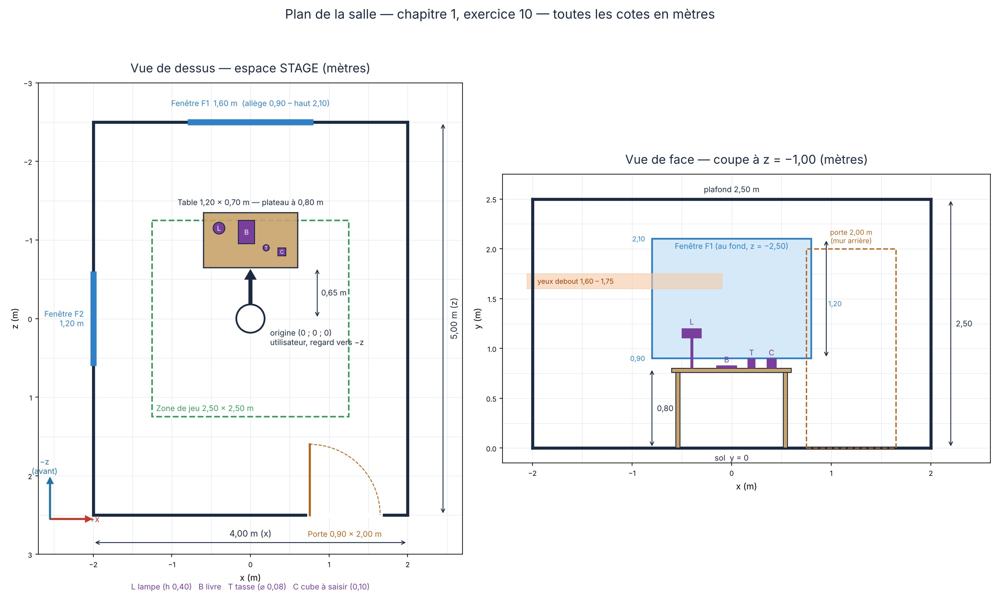

# Chapitre 1 — Exercice 10 : le plan de votre salle



*Plan de la salle, vue de dessus et vue de face. Le texte ci-dessous en donne toutes
les cotes, en mètres.*

## Le repère utilisé

Toutes les positions sont données dans l'espace **STAGE** du chapitre 2, avec la
convention du module (identique à OpenXR) :

- **origine** au sol, au centre de la zone de jeu, là où se tient l'utilisateur au départ ;
- **+x** vers la droite, **+y** vers le haut, **l'avant regarde les z négatifs** ;
- **y = 0** est le plancher : c'est le seul espace où cela a un sens physique ;
- toutes les longueurs sont en **mètres**.

Au démarrage, l'utilisateur regarde vers le mur du fond (z = − 2,5).

## La pièce

| Élément | Dimension |
|---|---|
| Largeur (selon x) | **4,00 m**, de x = − 2,00 à x = + 2,00 |
| Profondeur (selon z) | **5,00 m**, de z = − 2,50 (devant) à z = + 2,50 (derrière) |
| Hauteur sous plafond | **2,50 m** |
| Zone de jeu (au sol, centrée sur l'origine) | **2,50 m × 2,50 m**, de − 1,25 à + 1,25 sur x et sur z |

## Vue de dessus

```
                    z = -2,50   (mur de devant)
      x = -2,00  ┌───────────[== fenêtre F1 ==]───────────┐  x = +2,00
                 │                                        │
                 │                                        │
                 │            ┌──────────────┐            │
                 │            │  L    B      │  table     │
                 │            │        T  C  │  z = -1,00 │
   fenêtre F2  ║ │            └──────────────┘            │
   (z = 0)     ║ │   ┌ ─ ─ ─ ─ ─ ─ ─ ─ ─ ─ ─ ─ ─ ─ ┐      │
               ║ │   │ zone de jeu 2,50 × 2,50     │      │
                 │   │            ●  ← origine     │      │
                 │   │      (l'utilisateur, regard │      │
                 │   │       vers -z, vers le haut │      │
                 │   │       du schéma)            │      │
                 │   └ ─ ─ ─ ─ ─ ─ ─ ─ ─ ─ ─ ─ ─ ─ ┘      │
                 │                                        │
                 │                                        │
                 └──────────────────────────[ porte ]─────┘
                    z = +2,50   (mur de derrière)

   L = lampe   B = livre   T = tasse   C = cube à saisir
```

## La porte et les fenêtres

| Ouverture | Mur | Position du centre | Largeur | Bas | Haut |
|---|---|---|---:|---:|---:|
| **Porte** | derrière (z = + 2,50) | x = + 1,20 | 0,90 m | 0,00 m (au sol) | **2,00 m** |
| **Fenêtre F1** | devant (z = − 2,50) | x = 0,00 | 1,60 m | 0,90 m | 2,10 m |
| **Fenêtre F2** | gauche (x = − 2,00) | z = 0,00 | 1,20 m | 0,90 m | 2,10 m |

La porte va donc de x = 0,75 à x = 1,65. Le bas des fenêtres (0,90 m) est juste
au-dessus de la table (0,80 m), comme dans une vraie pièce. Leur haut (2,10 m)
laisse 40 cm sous le plafond.

## La table

| Propriété | Valeur |
|---|---|
| Position du centre (au sol) | x = 0,00, z = − 1,00 |
| Dimensions du plateau | 1,20 m (selon x) × 0,70 m (selon z) |
| **Hauteur du plateau** | **0,80 m** |
| Bord le plus proche de l'utilisateur | z = − 0,65 |

Le bord avant est à 0,65 m de l'origine : à portée de bras (0,60 à 0,75 m) sans
marcher, en se penchant un peu. Le plateau à 0,80 m est sous les mains d'une
personne debout, dont les yeux sont à 1,60 à 1,75 m.

## Ce qui est posé sur la table

Tous ces objets reposent sur le plateau : leur base est à **y = 0,80**.

| Objet | Centre de la base (x ; y ; z) | Dimensions | Rôle prévu |
|---|---|---|---|
| **Lampe** (L) | (− 0,40 ; 0,80 ; − 1,15) | pied ⌀ 0,15, hauteur 0,40 m | source de lumière de la salle |
| **Livre** (B) | (− 0,05 ; 0,80 ; − 1,10) | 0,21 × 0,03 × 0,30 m | objet posé, repère d'échelle |
| **Tasse** (T) | (+ 0,20 ; 0,80 ; − 0,90) | ⌀ 0,08, hauteur 0,10 m | repère d'échelle familier |
| **Cube** (C) | (+ 0,40 ; 0,80 ; − 0,85) | arête 0,10 m | objet à saisir avec la main |

Le cube et la tasse sont placés du côté de l'utilisateur et un peu à droite, pour être
atteints de la main droite sans marcher.

## Vue de face (du mur de devant, coupe à z = − 1,00)

```
 y (m)
 2,50 ┼────────────────────────── plafond ──────────────────────────┼
      │                                                             │
 2,10 │                ┌──────── fenêtre F1 (au fond) ────────┐     │
      │                │                                      │     │
      │                │                                      │     │
 1,70 │      ← yeux de l'utilisateur debout (1,60 à 1,75 m) → │     │
      │                │                                      │     │
 1,20 │      L ─┐      │                                      │     │
      │         │      │                                      │     │
 0,90 │         │      └──────────────────────────────────────┘     │
 0,80 │   ══════╧══════ B ═══ T ═══ C ═════  plateau de la table    │
      │   ║                              ║                          │
      │   ║                              ║                          │
 0,00 ┼───╨──────────────────────────────╨──────── sol ─────────────┼
     -2,00    -0,60                    +0,60                    +2,00   x (m)
```

## Pourquoi ces nombres comptent

- **Ce ne sont pas des unités arbitraires.** Un casque mesure le corps réel de
  l'utilisateur en mètres ; si la table était à « 32 unités », elle ne serait sous
  ses mains que par hasard.
- **Les objets familiers servent de repères d'échelle.** Tout le monde sait ce que
  mesurent une porte (2,00 m), une table (0,80 m) et une tasse : une erreur d'échelle
  se verra donc tout de suite, ou plutôt se sentira (« je me sens petit »).
- **Le repère STAGE est le seul possible.** Placer la table à y = 0,80 n'a de sens
  que si y = 0 est le sol. En LOCAL, elle serait à 0,80 m sous les yeux de
  l'utilisateur, qu'il soit debout ou assis.
- **Ces cotes serviront dès le chapitre 7** : chaque ligne de ce fichier deviendra une
  pose (une position, une orientation, pas d'échelle) dans le programme.
